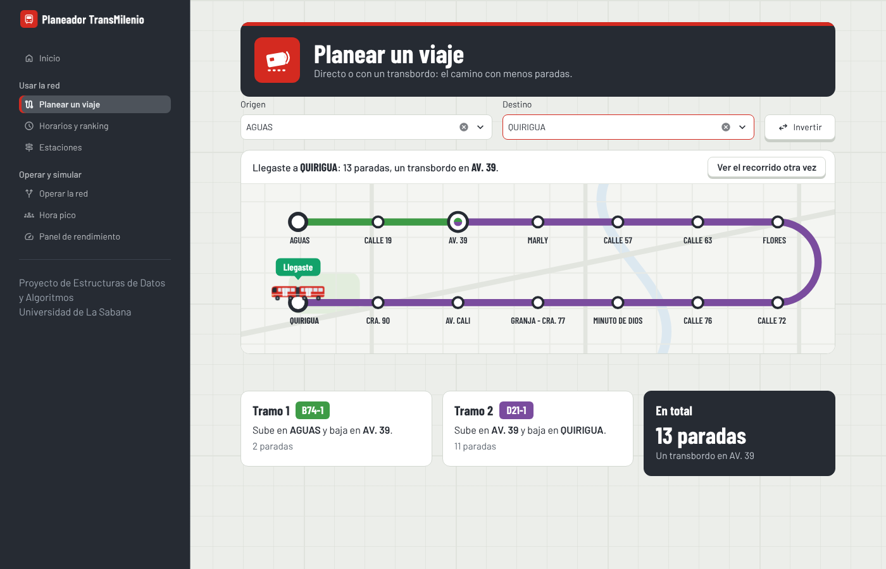
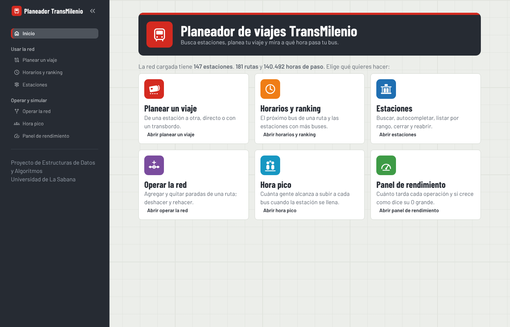
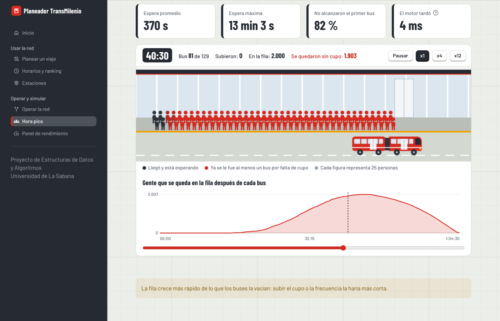
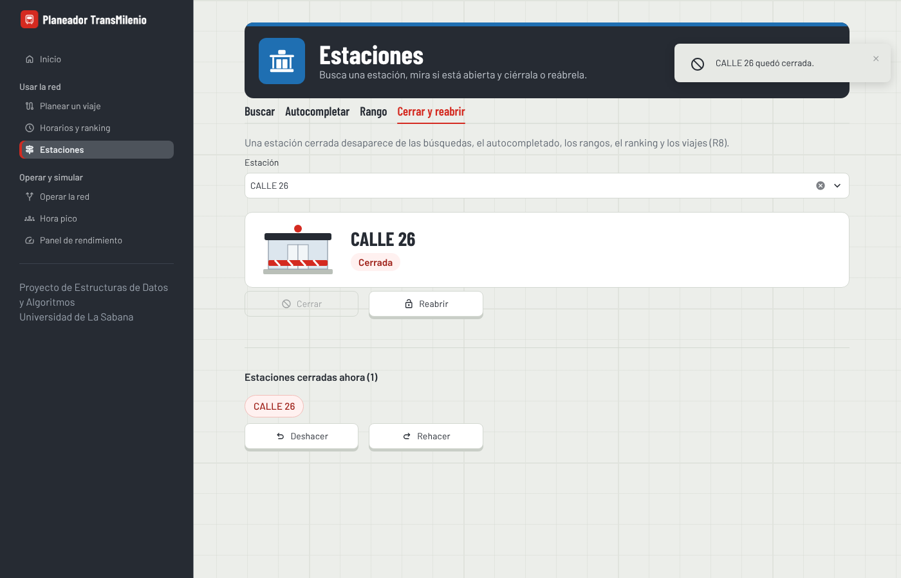
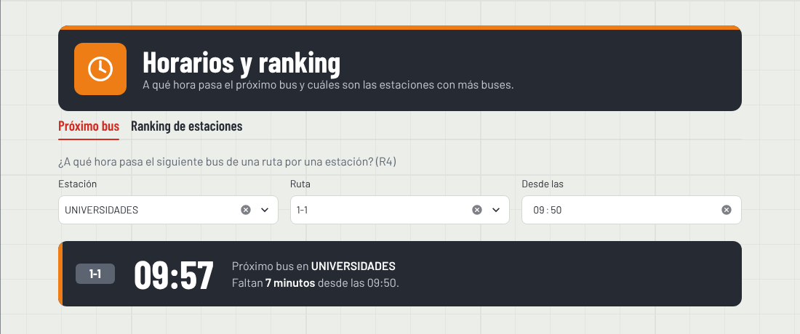
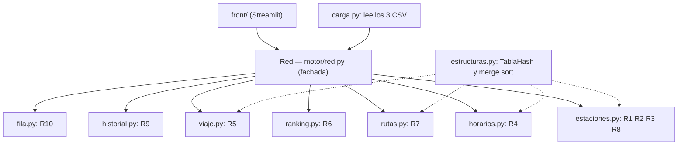
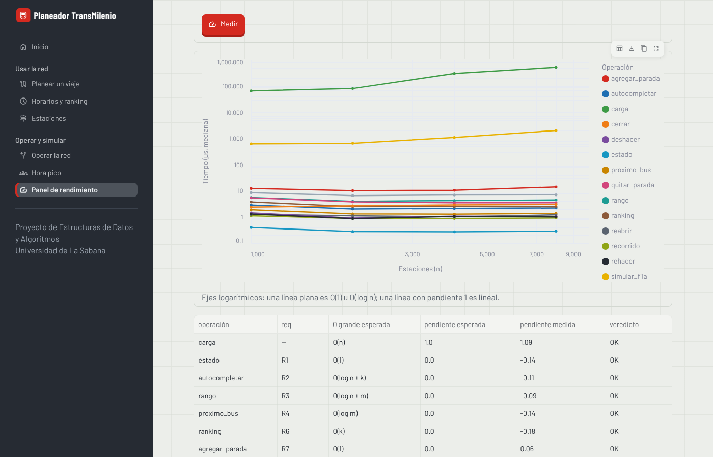

# Planeador de viajes TransMilenio

Aplicación web que permite buscar estaciones de TransMilenio, planear un viaje (directo o con un
transbordo), consultar a qué hora pasa el próximo bus, editar rutas, cerrar estaciones y simular la fila
de abordaje en hora pico. Todo se calcula con un **motor en Python escrito desde cero**: sin diccionarios,
sin conjuntos, sin `sorted`/`min`/`max` ni librerías externas. Las estructuras de datos y los algoritmos son
propios.

Proyecto del último corte de **Estructuras de Datos y Algoritmos** (Universidad de La Sabana), hecho por
Martín Fuentes Díaz, Miguel Delgado, Mauricio Vargas, Tomás Bermúdez y Juan David Riano.

| | |
|---|---|
| Motor | `motor/` — Python puro (solo `list`, `str`, `for`, `csv`, `time`, `random`) |
| Front | `front/` — Streamlit con tema, dibujos y animaciones propios; solo llama al motor |
| Datos | `datos/` — 147 estaciones, 181 rutas (1 927 filas de recorrido) y 140 492 horarios |



---

## Contenido

1. [Cómo arrancar](#cómo-arrancar)
2. [Qué hace la app](#qué-hace-la-app)
3. [Cómo está organizado](#cómo-está-organizado)
4. [Cómo está hecho el front](#cómo-está-hecho-el-front)
5. [Los datos](#los-datos)
6. [Usar el motor sin la web](#usar-el-motor-sin-la-web)
7. [Decisiones de diseño (R1–R10)](#decisiones-de-diseño-r1r10)
8. [Optimizaciones del motor](#optimizaciones-del-motor)
9. [Supuestos](#supuestos)
10. [Panel de rendimiento (R11)](#panel-de-rendimiento-r11)
11. [Pruebas](#pruebas)
12. [Convertir el GTFS real](#convertir-el-gtfs-real)
13. [Equipo y flujo de trabajo](#equipo-y-flujo-de-trabajo)
14. [App desplegada](#app-desplegada)

---

## Cómo arrancar

Requiere Python 3.10 o superior.

```bash
git clone https://github.com/Geodust-debug/Proy_transmilenio_alg.git
cd Proy_transmilenio_alg
python -m pip install -r requirements.txt
python -m streamlit run front/app.py
```

Streamlit abre la app en <http://localhost:8501>. Hay que arrancarla **desde la raíz del repositorio**:
así Streamlit encuentra `.streamlit/config.toml`, que trae los colores, las fuentes y el resto del tema.
El motor no necesita instalar nada: `requirements.txt` solo contiene `streamlit`, que usa el front.

---

## Qué hace la app

El menú lateral está agrupado como las líneas de un sistema de transporte. Cada página tiene su color de
troncal, un letrero de estación como título y una pequeña escena animada al entrar (un bus que llega, la
tarjeta que pasa por el torniquete, un reloj que corre en hora pico…).

| Página | Requisitos | Qué se puede hacer |
|---|---|---|
| **Planear un viaje** | R5 | Elegir origen y destino y ver al bus recorrer el mapa parada por parada, con el transbordo marcado |
| **Horarios y ranking** | R4, R6 | Ver en un tablero de salidas a qué hora pasa el próximo bus y cuántos minutos faltan; ranking de las estaciones con más buses |
| **Estaciones** | R1, R2, R3, R8 | Buscar una estación, autocompletar, listar un rango alfabético, cerrar y reabrir (la estación se dibuja abierta o con la barrera abajo) |
| **Operar la red** | R7, R9 | Ver el mapa de línea de una ruta, agregar o quitar paradas y deshacer o rehacer cualquier cambio |
| **Hora pico** | R10 | Simular la fila de abordaje en un andén animado: llegan buses, sube quien cabe y quien se queda se pone en rojo |
| **Panel de rendimiento** | R11 | Medir cada operación en redes de 1 000 a 80 000 estaciones y comprobar su O grande |

<p>
  
  
</p>
<p>
  
  
</p>

Los cambios hechos en una página (cerrar una estación, editar una ruta) se ven en todas las demás, porque
la app comparte una sola instancia del motor (`st.cache_resource` en `front/comun.py`).

---

## Cómo está organizado

```text
motor/              el motor: toda la lógica de R1 a R10
front/
  app.py            punto de entrada: menú, tema y página elegida
  inicio.py         página de inicio
  pages/            una página por grupo de requisitos
  visual/           tema, dibujos SVG y animaciones (Parte E)
  static/           fuentes Barlow y logo, servidos por Streamlit
.streamlit/         config.toml: colores, fuentes y opciones del tema
datos/              estaciones.csv, rutas.csv, horarios.csv
conversion/         convierte el GTFS real a los tres CSV
herramientas/       generador de redes sintéticas y medidor de rendimiento (R11)
pruebas/            pruebas del motor, del front y revisor de cosas prohibidas
docs/               reparto del trabajo, guías de estudio e imágenes
integrantes.md      quién hizo qué
```

### Arquitectura del motor

El front nunca toca las estructuras: habla con una **fachada**, la clase `Red` (`motor/red.py`). `Red` carga
los CSV una sola vez, reparte los datos entre los módulos y coordina los cambios para que todos queden
consistentes.



| Archivo | Responsabilidad |
|---|---|
| `motor/red.py` | Fachada. Expone el contrato público y orquesta los módulos. |
| `motor/carga.py` | Lee los tres CSV con `csv` y devuelve listas. |
| `motor/estructuras.py` | `TablaHash` propia (encadenamiento, rehash al pasar 0,75 de carga) y merge sort estable. |
| `motor/estaciones.py` | Estaciones: existencia, estado abierta/cerrada, autocompletar, rango y cierre. |
| `motor/horarios.py` | Horas de paso por (ruta, estación) y próximo bus. |
| `motor/ranking.py` | Estaciones ordenadas por cantidad de buses. |
| `motor/rutas.py` | Cada ruta como lista doblemente enlazada; agregar, quitar y recorrer. |
| `motor/historial.py` | Dos pilas para deshacer y rehacer. |
| `motor/viaje.py` | Grafo estación ↔ ruta y búsqueda del mejor viaje. |
| `motor/fila.py` | Ordenamiento por conteo y cola FIFO para la fila de abordaje. |

### Qué pasa cuando se edita la red

Cerrar una estación o agregar/quitar una parada afecta a varios módulos a la vez (el ranking cambia, el
grafo del viaje cambia, el historial debe anotarlo). Por eso todo cambio pasa por `Red`, que:

1. aplica el cambio con un método interno (`_aplicar_cierre`, `_aplicar_apertura`, `_aplicar_agregar`,
   `_aplicar_quitar`), que avisa a cada módulo afectado;
2. si salió bien, apila una tupla en el historial: `("cerrar", e)`, `("reabrir", e)`,
   `("agregar", ruta, nueva, despues_de)` o `("quitar", ruta, e, anterior)`;
3. al **deshacer** ejecuta la operación inversa con los mismos métodos internos, y al **rehacer** la directa.

Así deshacer no necesita copias de la red: solo recuerda *qué* se hizo.

---

## Cómo está hecho el front

El front sigue la regla del proyecto: **solo llama al motor**. Todo lo visual vive en `front/visual/` y
no contiene reglas del sistema; recibe lo que devuelve el motor y lo dibuja.

| Pieza | Qué hace |
|---|---|
| `front/app.py` | Arma el menú con `st.navigation`, aplica el tema, pone el logo y ejecuta la página elegida. |
| `visual/tema.py` | CSS global (plano de fondo, letreros, botones que se hunden al oprimirlos, cargas), el letrero de cada página, la escena de entrada y piezas reutilizables: insignias de ruta, fichas de estación, tablero de salidas, ranking con barras y mapa de línea. |
| `visual/dibujos.py` | Todos los dibujos en SVG hechos a mano (bus articulado, estación, torniquete, reloj, personas, iconos). No hay emojis ni imágenes descargadas. |
| `visual/animaciones.py` y `visual/plantillas/` | Las dos animaciones interactivas: el mapa del viaje y el andén de hora pico. Son páginas HTML pequeñas con JavaScript que se llenan con los datos del motor y se muestran con `components.html`. |
| `static/` | Fuentes Barlow y Barlow Condensed (licencia SIL OFL) y el logo; se sirven desde la app, así que funcionan sin internet. |

Decisiones de diseño de la interfaz:

- **Señalética sobre un plano en blanco.** El fondo es un plano de calles muy suave; los títulos son letreros
  grafito como los de una estación, y las rutas aparecen como insignias con el color de su troncal
  (B verde, F roja, G azul claro…).
- **Una animación por página, cuando se entra.** Dura menos de dos segundos y no bloquea los clics. Las demás
  animaciones responden a lo que hace el usuario: el bus avanza cuando se elige un viaje, la barrera baja al
  cerrar una estación, las barras del ranking crecen al cambiar cuántas se muestran.
- **El mapa del viaje** reparte las paradas en filas que se devuelven (como una serpiente), así un viaje de
  30 paradas cabe sin hacerse diminuto. El bus muestra encima la ruta en la que va y la cambia en el transbordo.
- **La hora pico** dibuja la fila en el andén: cada figura es una persona (o un grupo, si son miles). Quien ya
  vio pasar un bus lleno queda en rojo, y la gráfica de abajo marca en rojo cuánta gente se quedó después de
  cada bus.
- **Accesibilidad:** si el sistema pide reducir el movimiento (`prefers-reduced-motion`), las escenas de entrada
  no se muestran y las animaciones saltan al resultado final. Los botones tienen foco visible.

---

## Los datos

Tres CSV en `datos/`:

| Archivo | Columnas | Contenido |
|---|---|---|
| `estaciones.csv` | `nombre` | 147 estaciones, una por fila |
| `rutas.csv` | `ruta,orden,estacion` | 181 rutas; cada fila es una parada y su posición en la ruta |
| `horarios.csv` | `ruta,estacion,hora` | 140 492 horas de paso (`HH:MM`); vienen desordenadas y algunas repetidas |

Cada ruta va en **un solo sentido** (por ejemplo `F28-1`). Las horas se guardan en el motor como minutos
del día para poder compararlas como enteros.

---

## Usar el motor sin la web

```python
from motor import Red, simular_fila

red = Red("datos")                       # carga los tres CSV

red.estado("PORTAL NORTE")               # 'ABIERTA'  ('CERRADA' o 'NO EXISTE' según el caso)
red.autocompletar("POR", 3)              # ['PORTAL 20 DE JULIO', 'PORTAL 80', 'PORTAL AMERICAS']
red.rango("A", "C")                      # estaciones entre dos nombres, en orden alfabético
red.proximo_bus("UNIVERSIDADES", "1-1", "10:00")   # '10:08'  (None si no hay más ese día)
red.ranking(2)                           # [('RICAURTE', 4446), ('PORTAL NORTE', 3282)]
red.viaje("PORTAL NORTE", "PORTAL SUR")  # [('F28-1', 'PORTAL NORTE', 'AV. CHILE'),
                                         #  ('G22-1', 'AV. CHILE', 'PORTAL SUR')]
red.recorrido("1-1")                     # paradas de la ruta en orden
red.recorrido("1-1", al_reves=True)      # y en sentido contrario

red.cerrar("PORTAL NORTE")               # True
red.agregar_parada("1-1", "RICAURTE", "UNIVERSIDADES")   # True si se pudo
red.deshacer()                           # True; deshace lo último
red.rehacer()                            # True; lo vuelve a hacer

simular_fila([0, 1, 2, 3, 10], 5, 2)     # [5, 5, 10, 10, 15]: segundo en que sube cada persona
```

Las operaciones que pueden fallar (estación inexistente, ruta inexistente, nada que deshacer) devuelven
`False` o `None` en lugar de lanzar errores. La única excepción es `simular_fila` con frecuencia o capacidad
menores o iguales a 0, que lanza `ValueError`.

---

## Decisiones de diseño (R1–R10)

Notación: `n` se define en cada requisito. `S` = número de estaciones, `L` = filas de `rutas.csv`.

### R1 · Buscar una estación
**Estructura:** tabla hash propia (`TablaHash`, encadenamiento con rehash al pasar 0,75 de carga) de nombre →
posición, más un arreglo de banderas `cerrada`. **Algoritmo:** consulta directa por clave.
**Alternativas descartadas:** recorrer la lista (O(n)); búsqueda binaria sobre el arreglo ordenado (O(log n),
más lenta que la tabla hash). **O grande** (n = número de estaciones): **O(1)** promedio.

### R2 · Autocompletar
**Estructura:** arreglo con todos los nombres en orden alfabético (merge sort al cargar) y un árbol de Fenwick
con las estaciones abiertas. **Algoritmo:** búsqueda binaria de la primera estación ≥ prefijo y avance mientras
empiece por el prefijo; las cerradas se saltan con el árbol de Fenwick (siguiente abierta en O(log n)).
**Alternativas descartadas:** trie (gasta mucha memoria y no sirve para R3); recorrer toda la lista (O(n)).
**O grande** (n = estaciones, k = resultados pedidos): **O(log n + k)**.

### R3 · Listar un rango
**Estructura:** la misma de R2. **Algoritmo:** dos búsquedas binarias (inicio ≥ desde y fin > hasta) y
recorrido saltando cerradas. Si desde > hasta devuelve `[]`; los extremos no tienen que existir.
**Alternativa descartada:** filtrar toda la lista (O(n)). **O grande** (n = estaciones, m = resultados):
**O(log n + m)**.

### R4 · Próximo bus
**Estructura:** tabla hash propia con clave `(ruta, estación)` que apunta a una lista con las horas de ese par
como minutos del día, ordenadas (merge sort al cargar; en el CSV vienen desordenadas y a veces repetidas).
**Algoritmo:** búsqueda binaria de la primera hora ≥ la pedida (un bus exactamente a esa hora cuenta); `None`
si no hay más ese día, si el par no existe o si la estación está cerrada. **Alternativas descartadas:**
recorrer la lista (O(m)); ordenar en cada consulta (O(m log m)); guardar las horas como texto (comparaciones
frágiles). **O grande** (m = horarios de ese par en la estación): **O(log m)** por consulta; cargar
O(N log m) con N = filas de `horarios.csv`.

### R5 · Planear un viaje
**Estructura:** grafo bipartito estación ↔ ruta. Cada ruta es un arreglo ordenado de estaciones; cada estación
guarda una lista `[ruta, posición]` de las rutas que pasan por ella. Las estaciones se identifican con un
número entero usando una tabla hash propia (`TablaHash`). Además hay cuatro arreglos de trabajo de tamaño S
(`desde_o`, `hasta_d` y la ruta usada para cada uno) que se crean una sola vez, llenos de "infinito".

**Algoritmo:** búsqueda por niveles (como un BFS limitado a 2 rutas). Desde el origen se recorre hacia adelante
cada ruta que pasa por él y se anota, para cada estación alcanzable, el menor número de paradas; desde el
destino se hace lo mismo hacia atrás. Cada pasada guarda en una lista `tocados` qué estaciones cambió. El mejor
directo es el costo del origen al destino; el mejor con transbordo es el mínimo de
`desde_origen[t] + hasta_destino[t]`, buscado **solo entre las estaciones tocadas** (una estación de
transbordo tiene que estar en las dos listas, así que basta recorrer la más corta). Al final se limpian solo
las posiciones tocadas. Gana el de menos paradas; si empatan, el directo. Las estaciones cerradas no pueden
ser origen, destino ni transbordo.

**Alternativas descartadas:** BFS/Dijkstra sobre estaciones con estado (estación, ruta): sirve para cualquier
número de transbordos pero necesita cola de prioridad y es más complejo; como el enunciado limita a un
transbordo, los dos niveles bastan. Probar todos los pares de rutas: O(rutas²). Crear y recorrer arreglos de
tamaño S en cada consulta (era la primera versión): O(S + P) por consulta.

**O grande:** construir el índice O(L) (una vez, y otra vez tras editar una ruta); cada consulta **O(P)**, con
`P` = paradas de las rutas que pasan por el origen y el destino. No depende del tamaño de la red.

### R6 · Ranking
**Estructura:** arreglo de tuplas `(-buses, nombre)` ordenado con merge sort, guardado como caché.
**Algoritmo:** el orden se calcula una vez y solo se reconstruye cuando cambian los conteos de buses (se agrega
o quita una parada: `Horarios.version()`). Abrir o cerrar no cambia el orden, así que las estaciones cerradas
se saltan al consultar. Desempate: nombre alfabético. **Alternativas descartadas:** recalcular y ordenar en cada
consulta (O(n log n) por consulta); heap de las k mayores (hay que rehacerlo al cambiar k o los conteos);
quitar la estación del ranking al cerrarla (mover elementos O(n)). **O grande** (n = estaciones, k = pedidas,
c = cerradas que se saltan): consulta **O(k + c)**; reconstruir O(n log n) solo si cambiaron los conteos.

### R7 · Editar rutas
**Estructura:** una lista doblemente enlazada por ruta (nodos en arreglos paralelos `_est`, `_sig`, `_ant`, con
cabeza, cola y largo por ruta) y una tabla hash propia `(ruta, estación) → nodo` para encontrar cualquier
parada al instante. **Algoritmo:** agregar justo después de X = ubicar el nodo de X con la tabla hash y
reconectar cuatro punteros; quitar = enlazar entre sí el anterior y el siguiente; el recorrido normal sigue
`_sig` desde la cabeza y el recorrido al revés sigue `_ant` desde la cola. Devuelve `False` si la ruta o la
parada no existen, o si la estación nueva ya está en la ruta. `despues_de = None` inserta al inicio (lo usa
deshacer). **Alternativas descartadas:** arreglo por ruta (insertar/quitar mueve elementos, O(L)); lista simple
(recorrer al revés o quitar es O(L)); lista doble sin tabla hash (encontrar la parada es O(L)); árbol
balanceado (O(log L) y mucho más código). **O grande** (L = paradas de la ruta): agregar y quitar **O(1)**;
recorrido **O(L)**; cargar O(N log L) con N filas de `rutas.csv`.

Cuando se agrega una parada, sus horarios se copian de la parada `despues_de`; cuando se quita, sus horarios
se guardan en una papelera para poder restaurarlos si se deshace.

### R8 · Cerrar y reabrir estaciones
**Estructura:** bandera por estación + árbol de Fenwick (un 1 por estación abierta). **Algoritmo:** cambiar la
bandera y actualizar el árbol; el arreglo ordenado no se mueve. Devuelve `False` si la estación no existe o ya
estaba en ese estado. **Alternativas descartadas:** quitar/insertar en el arreglo al cerrar/reabrir (O(n));
saltar cerradas una por una (peor caso O(cerradas)); árbol AVL (más complejo para el mismo O(log n)).
**O grande** (n = estaciones): **O(log n)**.

### R9 · Deshacer y rehacer
**Estructura:** dos pilas (LIFO) con listas: operaciones hechas y operaciones deshechas. **Algoritmo:** cada
cierre, reapertura o edición exitosa se apila como una tupla y borra la pila de rehacer; deshacer pasa la cima
de una pila a la otra y la fachada ejecuta la operación inversa (por eso `quitar` guarda el `anterior`);
rehacer hace lo contrario. Si no hay nada, devuelve `False`. **Alternativas descartadas:** guardar una copia
completa de la red en cada cambio (O(tamaño de la red) de memoria y tiempo por cambio); una sola lista con
puntero (equivalente, pero las dos pilas se explican mejor). **O grande:** registrar, deshacer y rehacer
**O(1)**.

### R10 · Fila de abordaje
**Estructura:** la fila es una cola FIFO representada como un tramo `[cabeza, fin)` del arreglo de personas
ordenadas por llegada: encolar mueve `fin` y desencolar mueve `cabeza`, ambas en O(1) y sin copiar a nadie.

**Algoritmo:** (1) ordenar a las personas por (hora de llegada, posición original) de forma estable. Si las
llegadas son enteros dentro de un rango W ≤ 4n —el caso normal: segundos dentro de una ventana— se usa
**ordenamiento por conteo** (contar cuántas llegan en cada segundo, sumas acumuladas y repartir), O(n + W).
Si no (rangos enormes o llegadas con decimales), merge sort sobre pares `(llegada, posición)`, O(n log n).
(2) simular bus por bus: encolar a todos los que ya llegaron a la hora de salida y desencolar hasta
`capacidad`. Si la fila está vacía se salta directo al primer bus útil, así no se simulan buses vacíos. Quien
llega justo en el segundo en que sale un bus alcanza a subir.

**Alternativas descartadas:** `pop(0)` sobre una lista como cola (O(n) por extracción → O(n²)); ordenamientos
O(n²) (inviables con cientos de miles de personas); merge sort siempre (correcto, pero unas 4 veces más lento
cuando las llegadas caben en un rango pequeño); simular segundo a segundo (O(tiempo total), no O(n)).

**O grande** (n = número de personas): ordenar O(n) con conteo (O(n log n) con merge sort) + simular O(n) =
**O(n)** en el caso normal.

---

## Optimizaciones del motor

La Parte E revisó el motor sin cambiar su contrato ni sus resultados: `pruebas/probar_parte_e.py` compara cada
versión rápida con una versión lenta y obvia (fuerza bruta) y todas las demás pruebas siguen pasando. Solo se
tocaron archivos compartidos o de la Parte A (`estructuras.py`, `viaje.py`, `fila.py`), así que los módulos
de las partes B, C y D se benefician sin haber cambiado.

| Qué | Antes | Ahora | Medición |
|---|---|---|---|
| `viaje` (R5) | O(S + P): crea y recorre arreglos de tamaño S en cada consulta | O(P): arreglos reutilizables y lista de tocados | 1,95 ms → 0,017 ms por consulta en la red de 80 000 estaciones |
| `simular_fila` (R10) | Merge sort, O(n log n) | Conteo, O(n) | 195 ms → 33 ms con 80 000 personas |
| `TablaHash` | `hash % capacidad`, el hash se calculaba dos veces al insertar y otra vez al crecer | `hash & (capacidad − 1)`, un solo cálculo y el hash guardado en cada entrada | Insertar 150 000 claves: unos 20 % más rápido |
| `ordenar_mezcla` | Mezcla desde bloques de 1 | Bloques de 16 por inserción y bloques ya ordenados se copian sin mezclar | 10 % a 25 % más rápido según los datos |
| Cargar la red real | | | 275 ms → 257 ms |

Además, `herramientas/medir.py` ahora mide las consultas de solo lectura repitiéndolas 20 veces seguidas y
dividiendo. Una llamada de un microsegundo está por debajo de la precisión del reloj; repetirla hace que las
pendientes del panel salgan estables también con redes pequeñas.

---

## Supuestos

- **Una estación es su nombre**, en mayúsculas y sin tildes, tal como aparece en `estaciones.csv`.
- **Un viaje tiene como máximo un transbordo** y se mide en *paradas recorridas*, no en minutos ni en
  distancia. Gana el de menos paradas; con empate, el directo.
- **Estación cerrada** significa que no se puede abordar ni bajar en ella ni usarla de transbordo, y que no
  aparece en autocompletar, rango ni ranking. Las rutas que pasan por ella siguen existiendo.
- **Horarios de un solo día de operación.** `proximo_bus` no pasa a la madrugada del día siguiente: si ya no hay
  buses después de la hora pedida, devuelve `None`.
- **Un bus a la hora exacta cuenta** (`>=`), y las horas repetidas en el CSV se conservan.
- **Horas mayores a 24:00.** El GTFS usa horas como `25:10` para viajes que pasan de medianoche, pero el
  motor solo lee `HH:MM` dentro de un día. En `conversion/convertir_gtfs.py` esas horas se **envuelven**
  (`25:10` → `01:10`), porque son buses de la madrugada que también pasan en un día de operación típico; con
  `--horas-24 descartar` se ignoran.
- **Fila de abordaje:** los buses salen a `frecuencia`, `2·frecuencia`, … segundos; cada bus lleva como máximo
  `capacidad` personas y la gente sube en orden de llegada (en empate, el orden de la lista). En la página de
  hora pico las llegadas se generan al azar (con semilla fija) en forma de pico o pareja.

---

## Panel de rendimiento (R11)

La página **Panel de rendimiento** (`front/pages/6_Panel_rendimiento.py`) genera redes sintéticas con el
formato de los tres CSV (`herramientas/generar_red.py`), mide cada operación con la mediana de varias
repeticiones y calcula la **pendiente de log(tiempo) contra log(n)**: ≈ 0 es constante o logarítmico, ≈ 1 es
lineal. Junto a cada medición muestra la O grande esperada; el veredicto es *OK* si la pendiente medida está a
0,35 o menos de la esperada. Si una operación no coincide, la explicación aparece en la misma página.



También se puede correr por terminal:

```bash
python herramientas/medir.py 10000 20000 40000 80000
```

Resultado de una corrida en el equipo de desarrollo con los tamaños oficiales (los tiempos cambian de un
computador a otro; lo que importa es la pendiente, y valores cercanos a 0, positivos o negativos, son ruido):

| Operación | Req. | O grande esperada | Pendiente esperada | Pendiente medida | Veredicto |
|---|---|---|---|---|---|
| carga | — | O(n) | 1,0 | 1,11 | OK |
| estado | R1 | O(1) | 0,0 | −0,14 | OK |
| autocompletar | R2 | O(log n + k) | 0,0 | −0,14 | OK |
| rango | R3 | O(log n + m) | 0,0 | −0,11 | OK |
| proximo_bus | R4 | O(log m) | 0,0 | −0,14 | OK |
| ranking | R6 | O(k) | 0,0 | −0,19 | OK |
| agregar_parada | R7 | O(1) | 0,0 | 0,02 | OK |
| quitar_parada | R7 | O(1) | 0,0 | −0,16 | OK |
| recorrido | R7 | O(largo de la ruta) | 0,0 | −0,11 | OK |
| cerrar | R8 | O(log n) | 0,0 | 0,01 | OK |
| reabrir | R8 | O(log n) | 0,0 | −0,10 | OK |
| deshacer | R9 | O(1) | 0,0 | −0,08 | OK |
| rehacer | R9 | O(1) | 0,0 | −0,10 | OK |
| simular_fila | R10 | O(n) (conteo) | 1,0 | 1,05 | OK |
| viaje | R5 | O(P) | 0,0 | 0,19 | OK |

En estas redes cada ruta tiene 12 paradas y cada estación está en pocas rutas, así que P no crece con la red
y `viaje` queda plano, como se espera de O(P).

---

## Pruebas

Todas se corren desde la raíz del repositorio:

```bash
python pruebas/revisar_prohibidos.py     # motor/ no usa dict, set, sorted, min, max, .index, etc.
python pruebas/probar_parte_a.py         # R5, R10 y estructuras compartidas
python pruebas/probar_parte_b.py         # R1, R2, R3, R8
python pruebas/probar_parte_c.py         # R4, R6 y conversión del GTFS
python pruebas/probar_parte_d.py         # R7, R9
python pruebas/probar_parte_e.py         # optimizaciones contra fuerza bruta y las 7 páginas del front
python pruebas/probar_integracion.py     # todo el contrato junto, con los datos reales
```

`revisar_prohibidos.py` es el más importante antes de entregar: recorre `motor/` y falla si encuentra algo
que el enunciado prohíbe.

---

## Convertir el GTFS real

`conversion/convertir_gtfs.py` genera los tres CSV a partir del GTFS de TransMilenio, usando solo la
biblioteca estándar (`zipfile` y `csv`, leyendo por streaming en dos pasadas):

```bash
python conversion/convertir_gtfs.py ruta/al/gtfs.zip datos/
python conversion/convertir_gtfs.py ruta/al/gtfs.zip datos/ --horas-24 descartar
```

Decisiones de la conversión:

- Estación = nombre de la parada en mayúsculas, sin tildes y con espacios simples; varios andenes con el mismo
  nombre quedan como **una** estación.
- Ruta = `<nombre corto>-<sentido>` (1 o 2).
- Si una ruta tiene varios recorridos en un mismo sentido, se usa el **más frecuente**; los demás viajes se
  ignoran.
- Una estación repetida de forma consecutiva (dos andenes seguidos) se colapsa.

> El script fue probado con un GTFS pequeño de prueba. Con el GTFS real conviene revisar `stops.txt`: si los
> nombres traen sufijos como "- Andén 1", hay que ajustar `nombre_estacion()`.

---

## Equipo y flujo de trabajo

| Integrante | Requisitos | Archivos principales |
|---|---|---|
| Martín Fuentes Díaz | Base del repo (fachada `Red`, carga, estructuras), R5, R10, R11 | `motor/red.py`, `motor/carga.py`, `motor/estructuras.py`, `motor/viaje.py`, `motor/fila.py`, `herramientas/` |
| Miguel Delgado | R1, R2, R3, R8 | `motor/estaciones.py` |
| Mauricio Vargas | R4, R6, conversión del GTFS | `motor/horarios.py`, `motor/ranking.py`, `conversion/` |
| Tomás Bermúdez | R7, R9 | `motor/rutas.py`, `motor/historial.py` |
| Juan David Riano | Parte E: optimización del motor, diseño y animaciones del front | `front/visual/`, `front/app.py`, `front/static/`, `.streamlit/` |

Más detalle en [`integrantes.md`](integrantes.md) y [`docs/reparto.md`](docs/reparto.md).

El repositorio se dividió para que cada parte pueda hacer push sin pisarse: cada integrante edita solo sus
archivos y `motor/red.py` (la fachada) no se toca. Flujo habitual:

```bash
git pull                                  # traer lo último antes de empezar
python pruebas/probar_integracion.py      # comprobar que todo sigue funcionando
git add .
git commit -m "Parte X: descripción corta"
git push
```

---

## App desplegada

*(Pendiente: aquí va la URL de la app cuando se despliegue en Streamlit Community Cloud.)*
